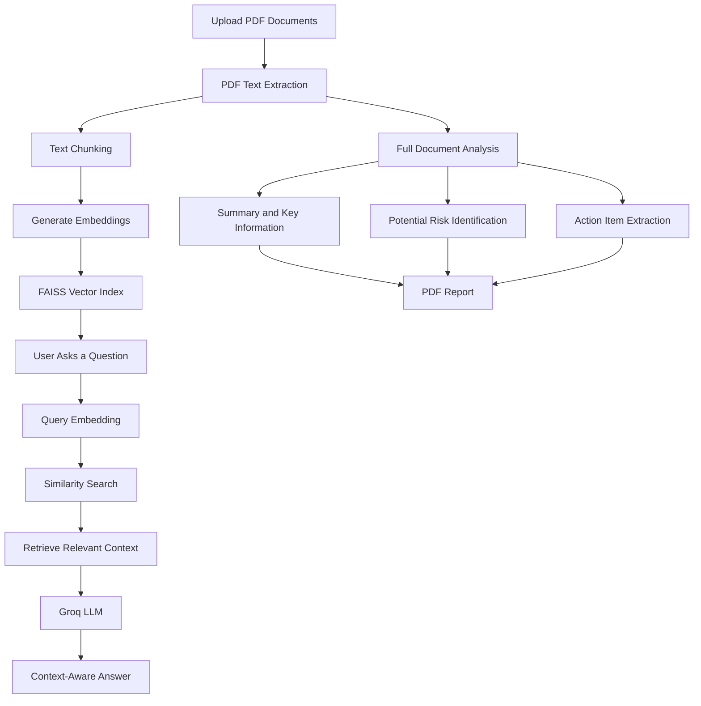

# 🧠 DocuMind AI

### AI-Powered Document Intelligence & Business Automation Agent

**Turn complex business documents into actionable intelligence.**

DocuMind AI is an AI-powered document intelligence application that helps users understand PDF documents, ask context-aware questions, identify potential risks, extract important information, and generate structured reports.

Built using **Python, Streamlit, Retrieval-Augmented Generation (RAG), FAISS, Sentence Transformers, and Groq LLMs**

---

## 📌 Table of Contents

* [Overview](#-overview)
* [Why DocuMind AI?](#-why-documind-ai)
* [Key Features](#-key-features)
* [Application Workflow](#-application-workflow)
* [System Architecture](#-system-architecture)
* [Technology Stack](#-technology-stack)
* [Project Structure](#-project-structure)
* [Installation and Setup](#-installation-and-setup)
* [How to Use](#-how-to-use)
* [Example Use Cases](#-example-use-cases)
* [Current Limitations](#-current-limitations)
* [Future Improvements](#-future-improvements)
* [Security and Responsible AI](#-security-and-responsible-ai)
* [Author](#-author)

---

## 🚀 Overview

Businesses work with large amounts of documents every day, including:

* Contracts and agreements
* Business proposals
* Financial reports
* Project documentation
* Policy documents
* Operational reports

Manually reviewing these documents can be time-consuming. Important information, potential risks, and action items may also be overlooked.

**DocuMind AI addresses this challenge through an AI-powered document analysis workflow.**

Users can upload PDF documents, process their content, ask questions in natural language, and receive structured AI-generated insights with relevant document references.

The application combines semantic search with Large Language Models (LLMs) to make document interaction more efficient.

---

## 💡 Why DocuMind AI?

Traditional document review generally requires users to read and search through documents manually.

DocuMind AI introduces a more interactive approach:

| Traditional Approach                | DocuMind AI                       |
| ----------------------------------- | --------------------------------- |
| Manually read lengthy PDFs          | AI-assisted document summaries    |
| Search using exact keywords         | Semantic document retrieval       |
| Manually identify important details | Structured information extraction |
| Review potential risks manually     | AI-assisted risk identification   |
| Prepare reports manually            | Downloadable PDF reports          |

---

## ✨ Key Features

### 📄 1. Intelligent PDF Processing

* Upload text-based PDF documents.
* Extract text page by page.
* Preserve page-level source information.
* Prepare extracted content for semantic retrieval.

### 🔍 2. Retrieval-Augmented Generation (RAG)

* Split extracted text into smaller chunks.
* Generate embeddings using Sentence Transformers.
* Store document embeddings in a FAISS vector index.
* Retrieve the most relevant chunks for user questions.
* Provide context-grounded responses with source information.

### 💬 3. AI-Powered Document Chat

Interact with uploaded documents using natural language.

Example questions:

* What is the main objective of this agreement?
* What are the important payment terms?
* Identify the major responsibilities of each party.
* What are the important deadlines?
* Are there any potential risks mentioned in this document?

### 📊 4. Risk Intelligence

The AI analysis identifies potential risks and organizes them into structured information, including:

* Risk level
* Risk description
* Supporting evidence
* Source document
* Page reference

### ⚡ 5. Action Item Extraction

Automatically extracts useful action-related information, such as:

* Task description
* Assigned owner, when available
* Deadline, when available
* Priority

### 📑 6. AI-Generated Reports

Generate downloadable PDF reports containing structured document analysis and insights.

---

## 🔄 Application Workflow

The application follows a document-processing and retrieval pipeline.



---

## 🏗️ System Architecture

DocuMind AI uses a modular architecture to separate document processing, retrieval, AI generation, and report creation.

| Component             | Responsibility                               |
| --------------------- | -------------------------------------------- |
| Streamlit Application | User interface and application workflow      |
| PDF Processor         | PDF validation and text extraction           |
| RAG Engine            | Chunking, embeddings, and semantic retrieval |
| FAISS                 | Similarity-based vector search               |
| AI Engine             | LLM-based analysis and question answering    |
| Report Generator      | PDF report generation                        |
| Configuration         | Environment variables and model settings     |

### RAG Pipeline

The RAG pipeline works in two main stages.

**Stage 1: Document Indexing**

1. User uploads a PDF.
2. Text is extracted using PyMuPDF.
3. Extracted text is divided into chunks.
4. Sentence Transformers converts chunks into embeddings.
5. FAISS stores the vectors for similarity search.

**Stage 2: Question Answering**

1. User enters a question.
2. The question is converted into an embedding.
3. FAISS retrieves the top 5 relevant chunks.
4. Retrieved context is passed to the Groq LLM.
5. The LLM generates an answer grounded in the retrieved content.

---

## 🛠️ Technology Stack

| Technology              | Purpose                     |
| ----------------------- | --------------------------- |
| Python                  | Core programming language   |
| Streamlit               | Interactive web application |
| PyMuPDF                 | PDF text extraction         |
| Sentence Transformers   | Text embeddings             |
| all-MiniLM-L6-v2        | Embedding model             |
| FAISS                   | Vector similarity search    |
| Groq API                | LLM inference               |
| Llama 3.3 70B Versatile | Configured language model   |
| ReportLab               | PDF report generation       |
| python-dotenv           | Environment configuration   |

---

## 📁 Project Structure

```text
Ai-powered-Document-intelligence-system/
│
├── app.py
│
├── config/
│   └── settings.py
│
├── modules/
│   ├── pdf_processor.py
│   ├── rag_engine.py
│   ├── ai_engine.py
│   └── report_generator.py
│
├── prompts/
│
├── sample_documents/
│
├── reports/
│
├── tests/
│
├── .env.example
├── .gitignore
├── requirements.txt
└── README.md
```

---

## ⚙️ Installation and Setup

Follow these steps to run DocuMind AI locally.

### 1. Clone the Repository

```bash
git clone https://github.com/Aditya-choudhary166/Ai-powered-Document-intelligence-system.git
```

### 2. Navigate to the Project

```bash
cd Ai-powered-Document-intelligence-system
```

### 3. Create a Virtual Environment

```bash
python -m venv .venv
```

Activate it:

**Windows PowerShell**

```powershell
.venv\Scripts\Activate.ps1
```

**macOS / Linux**

```bash
source .venv/bin/activate
```

### 4. Install Dependencies

```bash
pip install -r requirements.txt
```

### 5. Configure Environment Variables

Create a `.env` file in the project root using `.env.example` as a reference.

Add your Groq API key:

```env
GROQ_API_KEY=your_groq_api_key
GROQ_MODEL=llama-3.3-70b-versatile
```

Get an API key from the Groq Console.

### 6. Run the Application

```bash
streamlit run app.py
```

The application will open in your browser.

> **Note:** On the first run, Sentence Transformers downloads the embedding model. An internet connection is required for this initial download.

---

## 🖥️ How to Use

**Step 1 — Upload Documents**

Open Document Analysis and upload one or more text-based PDF files.

**Step 2 — Process Documents**

Click the processing option to extract PDF text, generate embeddings, and build the FAISS index.

**Step 3 — Run AI Analysis**

Start full AI analysis to generate a summary, key information, potential risks, and action items.

**Step 4 — Ask Questions**

Open AI Chat and ask questions about the uploaded documents.

**Step 5 — Review Insights**

Explore the extracted information and potential risks through the application dashboard.

**Step 6 — Generate Reports**

Open Reports and download the generated PDF report.

---

## 🎯 Example Use Cases

DocuMind AI can be useful in different business scenarios:

**Contract Review**

Understand agreement terms, identify potential risks, and extract important deadlines.

**Business Documentation**

Summarize lengthy business proposals and extract key information.

**Project Management**

Identify tasks, responsibilities, and deadlines from project documents.

**Policy Analysis**

Ask questions about internal policies and retrieve relevant document information.

---

## ⚠️ Current Limitations

This project is currently an MVP/prototype. Some limitations are:

* OCR for scanned or image-only PDFs is not included.
* Document processing and application data are maintained within the Streamlit session rather than a persistent database.
* Authentication and role-based access control are not implemented.
* AI-generated risks and insights require human verification.
* LLM requests send relevant document content to the Groq API. Avoid uploading confidential documents unless permitted by your organization's policies.
* The application is not a replacement for professional legal or compliance review.

---

## 🔮 Future Improvements

The following features can be considered for future development:

* OCR support for scanned documents.
* Support for DOCX, TXT, and additional document formats.
* Persistent document storage and database integration.
* User authentication and role-based access.
* Multi-user workspace and document management.
* Advanced document comparison.
* More detailed analytics and audit history.
* Deployment with production-level monitoring and security controls.

---

## 🔐 Security and Responsible AI

* API credentials should be stored in environment variables.
* Never commit `.env` files or API keys to GitHub.
* AI-generated information should be reviewed before business decisions.
* Document content should be handled according to applicable privacy and security policies.

---

## 👨‍💻 Author

**Aditya Choudhary**

B.Tech — Artificial Intelligence & Machine Learning

Interested in Artificial Intelligence, Machine Learning, Generative AI, NLP, and building practical AI-powered applications.

* **GitHub:** https://github.com/Aditya-choudhary166
* **Project Repository:** https://github.com/Aditya-choudhary166/Ai-powered-Document-intelligence-system

---

<p align="center">

### 🚀 Making Business Documents More Intelligent with AI

**Built with Python, RAG, FAISS, and LLMs.**

</p>
